# MeloX

[简体中文](README.md) | [English](README.en.md)

[](https://github.com/youshen2/MeloX/blob/master/LICENSE)
[](https://github.com/youshen2/MeloX/releases)
[](https://github.com/youshen2/MeloX/stargazers)

<p align="center">
  面向 iPhone、iPad、Mac 与 Apple Watch，使用原生 SwiftUI 构建的第三方网易云音乐播放器
</p>

[](https://melox.luoxe.cn)

[](https://t.me/melox_official)

> MeloX 是非官方开源项目，与网易云音乐及其关联公司不存在隶属、合作或授权关系。项目仍在开发中，接口和功能可能随网易云音乐服务变化而失效。

> [!IMPORTANT]
> **Apple Watch 版本仍在开发中。** 当前功能、交互和数据兼容性尚未稳定，不建议将其视为正式版本。

## 免责声明

本项目出于学习与研究目的开发。MeloX 不对 GPLv3 覆盖的主体代码附加额外限制；
第三方代码、资源和模型仍按上文列出的独立许可证使用。使用者应自行遵守所在地法律法规、
网易云音乐服务条款以及音乐内容的版权要求。

项目按许可证所述不提供担保；
因使用本项目产生的风险由使用者自行承担。

下载后请于24小时内删除。

## 应用截图

### MeloX Desktop（macOS）

MeloX Desktop 使用为 Mac 原生设计的侧边栏、多栏内容区与常驻底部播放器，在更大的横向空间中同时呈现浏览、歌词和播放队列。沉浸式播放器支持封面、逐字歌词、播放控制与音量调节，并可在歌词和队列侧栏间切换；也可以留在首页直接并排查看同步歌词。

桌面端还提供自动续播队列、适配宽屏的歌单详情，以及消息、音乐云盘、下载与设置入口。官网提供经过 Developer ID 签名和 Apple 公证的 Apple Silicon 与 Intel DMG；GitHub Releases 中则提供对应架构的未签名 CI 构建。更多信息与下载方式见 [MeloX 官网](https://melox.luoxe.cn/)。

<p align="center">
  
  
  <br>
  
  
  <br>
  
  
</p>

### 基础页面

<p align="center">
  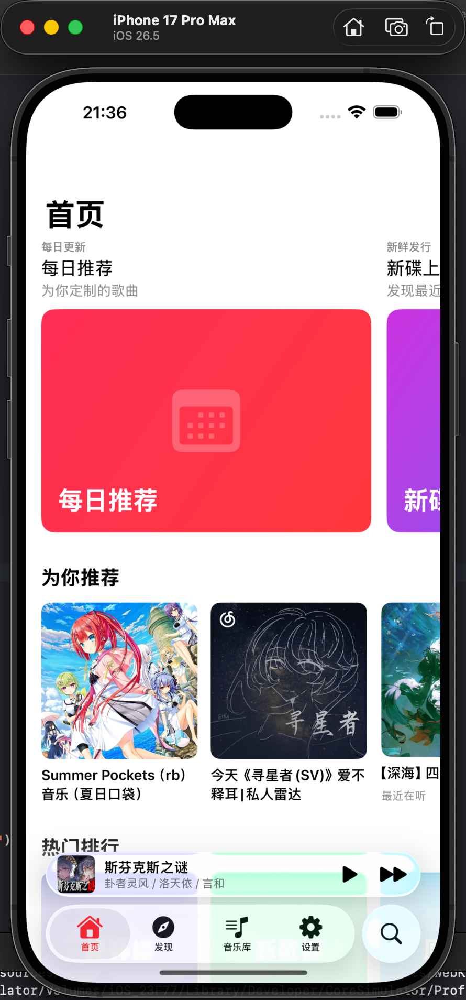
  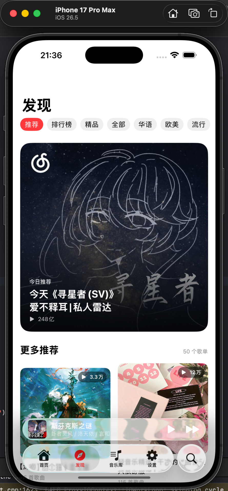
  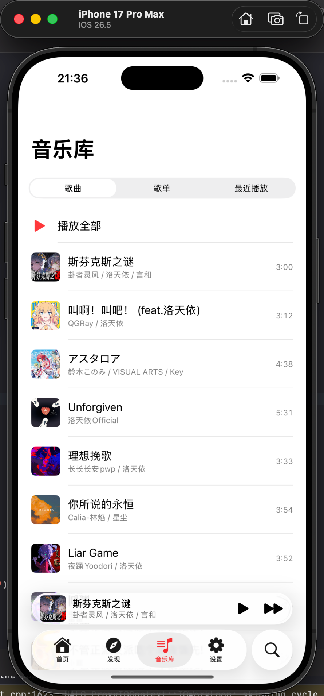
  <br>
  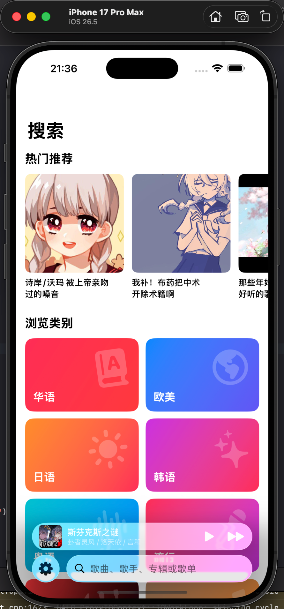
  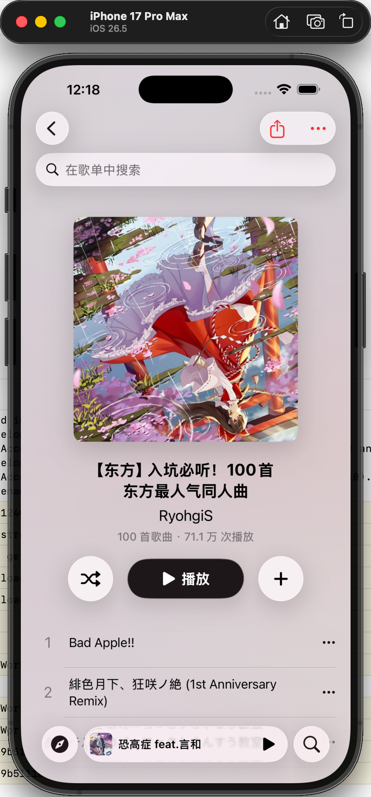
</p>

### 私信功能

<p align="center">
  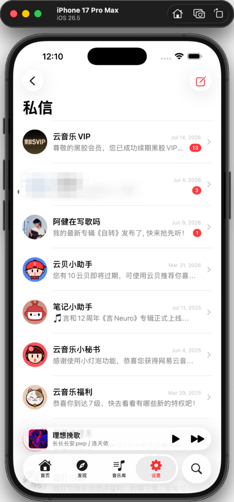
  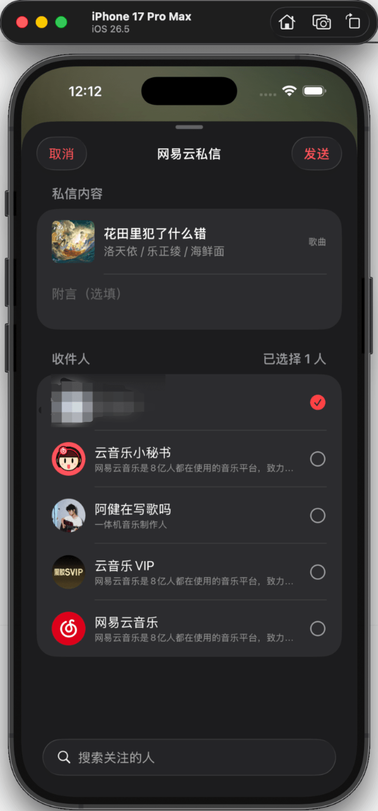
</p>

### 播放器

> PS：歌词已实现和Apple Music类似的动效，
> 包括但不限于：
> - 错峰歌词
> - 逐字辉光
> - 可切换的按词/按字抬升
> 等

<p align="center">
  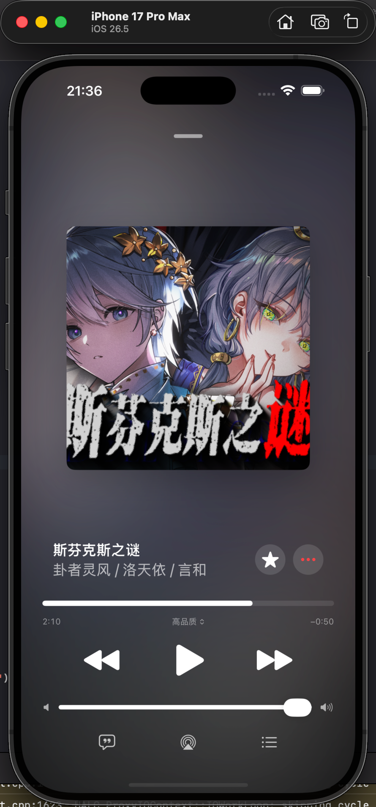
  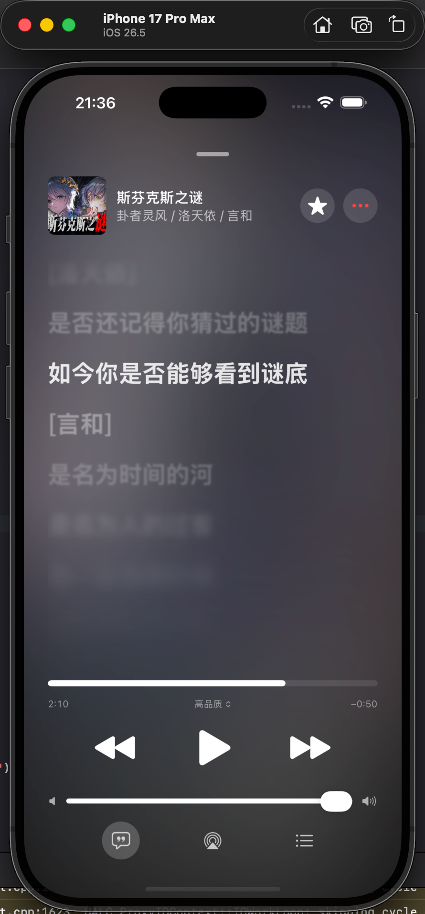
  
</p>

### 横屏播放器

<p align="center">
  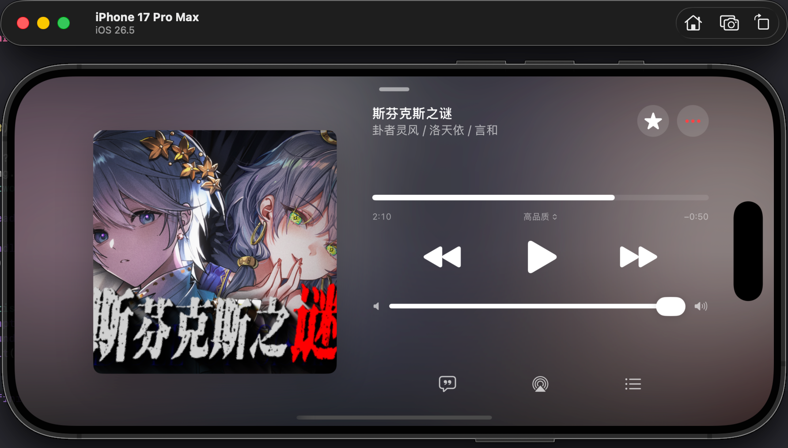
  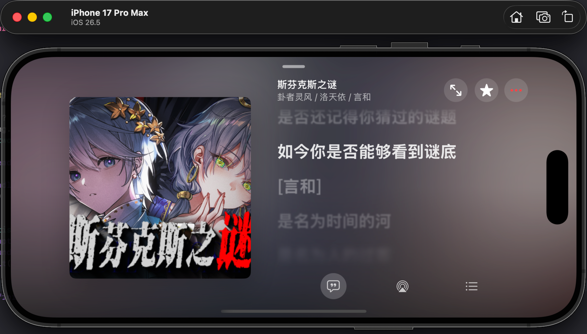
</p>

### [特色功能]全屏天际歌词

来自小米yu7天际屏的灵感。

<p align="center">
  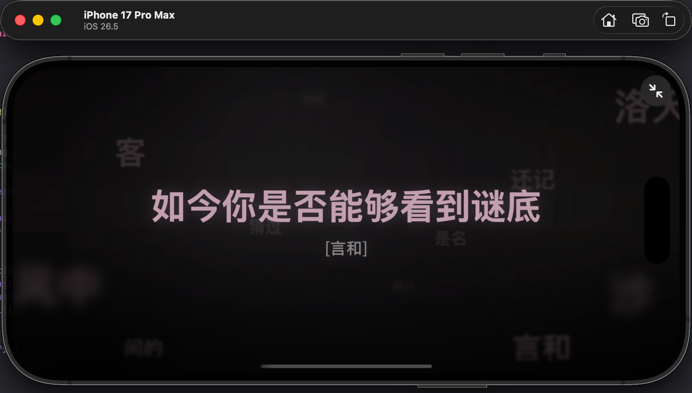
</p>

### [特色功能]文字PV歌词

文字 PV 的模板设计、视觉效果及原始实现来自 DanteAlighieri13210914 开发的
[PV Tool](https://github.com/DanteAlighieri13210914/pv-tool)（Copyright © 2026
DanteAlighieri13210914）。
MeloX 将相关内容移植为原生 SwiftUI，并根据歌词播放进度实时渲染；目前内置 18 种风格，
支持调节动效强度与动画速度，也可在全屏播放器中展示。

> **许可提醒：** 文字 PV 模板、效果实现及相关衍生内容受 PV Tool
> [Non-Commercial License](MeloX/Resources/PVTool-LICENSE.txt) 单独约束，仅可用于非商业用途。
> MeloX 的 GPLv3 许可证不会覆盖或替代该许可。用于商业产品、付费服务或商业化嵌入前，
> 必须另行取得原作者授权；详情请参阅[商业授权说明](MeloX/Resources/PVTool-COMMERCIAL.md)。

<p align="center">
  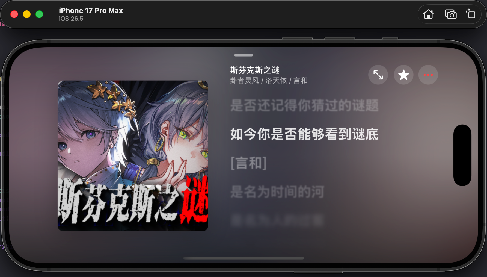
</p>

### EVA样式歌词（？）

<p align="center">
  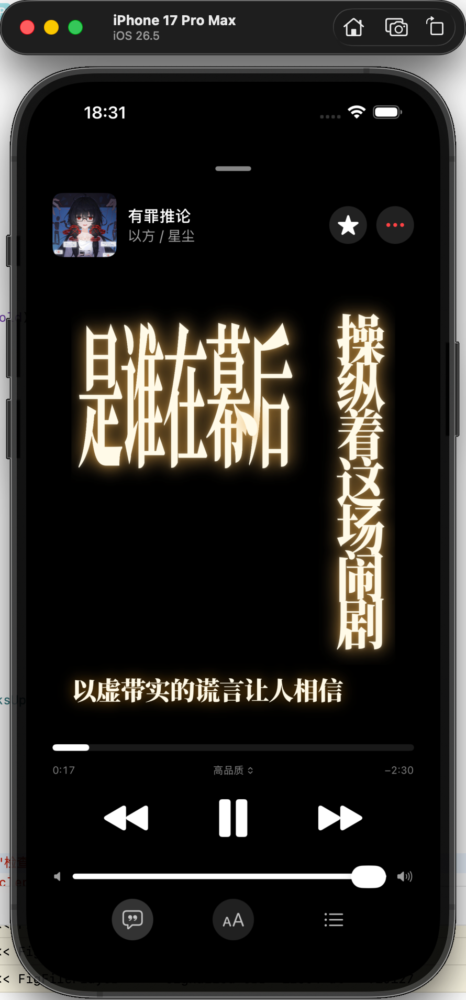
</p>

### Apple Watch（开发中）

手表端目前支持独立登录、搜索、每日推荐、歌单浏览、本地播放与同步歌词。播放器采用横向分页

> 手表端仍处于持续开发阶段，功能范围、界面和最低系统要求可能在后续版本中调整。

<p align="center">
  
  
  
</p>
<p align="center">
  
</p>

## 功能

- 一起听
- 心动模式
- 听歌识曲
- 私人漫游
- 私人雷达
- 相似歌曲
- 相似歌曲自动播放

- 个性化首页推荐
- 编辑推荐
- 每日推荐
- 推荐歌单
- 精品歌单
- 分类歌单
- 排行榜
- 热歌榜
- 热门歌手
- 新碟上架
- 新歌速递
- 个性化新歌推荐
- 近期云村热播
- 地区热门歌曲
- 喜爱歌曲漫游
- 喜爱歌曲推荐
- 个人歌单
- 已听播客推荐

- 搜索联想与输入补全
- 歌曲搜索
- 专辑搜索
- 歌手搜索
- 歌单搜索
- 播客搜索
- 歌曲详情
- 歌单详情
- 专辑详情
- 歌手详情
- 歌手关注与已关注歌手音乐库
- 歌曲百科
- 歌曲评论
- 评论回复

- 精选播客
- 个性化播客推荐
- 播客节目推荐
- 播客分类浏览
- 播客详情
- 播客节目列表
- 播客节目详情
- 播客节目搜索
- 播客订阅
- 播客节目播放

- 网易云官方网页登录
- 个人主页
- 歌曲收藏
- 歌单收藏
- 专辑收藏
- 新建公开与私密歌单
- 删除自建歌单
- 添加歌曲到歌单
- 从自建歌单移除歌曲
- 播放历史
- 网易云播放记录同步
- 网易云听歌时长同步
- 音乐云盘
- 云盘歌曲上传
- 云盘歌曲删除

- 网易云私信
- 私信联系人
- 私信文本消息
- 内容分享到私信
- 转发到动态
- 系统分享

- 标准音质
- 高品质音质
- 无损音质
- Hi-Res 音质
- 高清环绕声
- 沉浸环绕声
- 超清母带
- 迷你播放器
- 竖屏播放器
- 横屏播放器
- 播放队列
- 添加到播放队列
- 播放队列排序
- 随机播放
- 列表循环
- 单曲循环
- 播放进度控制
- 系统音量控制
- 独立音量控制
- 后台播放
- 锁屏播放信息
- 系统媒体控制
- 耳机与音频路由处理
- 播放状态恢复
- 智能自动混音
- 固定交叉淡化
- 歌曲速度匹配
- 10 段图形均衡器
- 均衡器预设
- 流动光影背景
- 模糊封面背景
- 重拍暗角
- 播放器屏幕常亮

- 歌曲下载
- 歌曲多选下载
- 歌单批量下载
- 专辑批量下载
- 排行榜批量下载
- 多档下载音质
- 离线播放
- 按播放次数自动缓存
- 下载任务管理
- 本地下载管理

- LRC 逐行歌词
- YRC 官方逐字歌词
- 伪逐字歌词
- 翻译歌词
- 罗马音歌词
- Apple Music 样式歌词
- EVA 样式歌词
- 文字 PV 歌词
- 全屏天际歌词
- 逐字歌词高光
- 按词抬升
- 按字抬升
- 逐字歌词辉光
- 长音膨胀
- 前奏与间奏倒计时
- 歌词跳转
- 歌词分享
- 歌词自动跟随
- 歌词提前量
- 悬浮窗歌词
- 画中画歌词控制
- 系统播放信息歌词
- 通知歌词
- 实时活动歌词
- 灵动岛歌词

- iPhone 原生界面
- iPad 原生界面
- Mac 原生侧边栏与多栏界面
- Mac 常驻底部播放器
- Mac 沉浸式播放器
- Mac 歌词与播放队列侧栏
- Mac 桌面歌词与迷你播放器
- Mac 键盘与系统媒体控制
- Apple Silicon 与 Intel 原生构建
- 浅色与深色主题
- 自定义首页
- 自定义标签栏
- 自定义音乐库
- 首次启动引导
- 自动检查更新
- 更新日志

- Apple Watch 独立登录
- Apple Watch 与 iPhone 账号同步
- Apple Watch 歌曲搜索
- Apple Watch 每日推荐
- Apple Watch 歌单浏览
- Apple Watch 独立播放
- Apple Watch 播放队列
- Apple Watch 播放模式
- Apple Watch 播放状态恢复
- Apple Watch 逐字歌词
- Apple Watch 翻译歌词
- Apple Watch 罗马音歌词

## 智能自动混音

智能自动混音使用 Mojtaba Heydari 开发的 [BeatNet](https://github.com/mjhydri/BeatNet)
通用模型转换而来的 Core ML 模型，用于在设备上分析歌曲的节拍、重拍、速度和开头能量。

MeloX 使用固定 32 秒窗口、FP16 计算精度的 Core ML ML Program；模型输出节拍与重拍激活概率，
特征提取和时序解码由 MeloX 在设备端完成。模型以
[CC BY 4.0](https://creativecommons.org/licenses/by/4.0/) 授权，转换与归属说明见
[BeatNet model notice](MeloX/Resources/Models/BeatNet/BeatNet-NOTICE.md)。

## 运行环境

- Xcode 27.1 或更高版本
- iOS / iPadOS 26.0 或更高版本
- macOS 15.0 或更高版本
- watchOS 10.0 或更高版本（手表端仍在开发中）
- Swift 5
- 用真机运行时，需要可用于代码签名的 Apple Developer 账号

## 本地构建

1. 克隆仓库：

   ```bash
   git clone https://github.com/youshen2/MeloX.git MeloX
   cd MeloX
   ```

2. 使用 Xcode 打开项目：

   ```bash
   open MeloX.xcodeproj
   ```

3. 移动端选择 `MeloX` Target，桌面端选择 `MeloX Desktop` Target；在 Signing & Capabilities 中设置自己的开发团队，如有需要，同时更换为唯一的 Bundle Identifier。

4. 选择兼容的 iPhone、iPad、Mac 或模拟器，然后构建运行。

无需部署额外的后端服务，也无需配置第三方 API 地址。

## 项目结构

```text
.
├── MeloX/
│   ├── App/                  # 应用入口、根视图与应用级导航
│   ├── Core/
│   │   ├── Artwork/          # 封面颜色与视觉数据
│   │   ├── Cloud/            # 云盘模型与状态
│   │   ├── Downloads/        # 下载存储与传输
│   │   ├── Library/          # 账号音乐库状态与收藏操作
│   │   ├── Lyrics/           # LRC / YRC 模型和解析
│   │   ├── Models/           # 按账号、音乐、网络和社交分类的业务模型
│   │   ├── Networking/       # 网易云接口与直接请求客户端
│   │   ├── Playback/         # AutoMix、播放引擎、均衡器、队列和媒体会话
│   │   ├── Settings/         # 应用、歌词与播放偏好
│   │   └── Updates/          # 版本与更新服务
│   ├── Features/
│   │   ├── Player/           # Now Playing、歌词渲染方案、TextPV 与播放队列
│   │   ├── Settings/         # 按账号、应用、歌词、播放和系统能力分类的设置页面
│   │   └── …                 # 首页、发现、搜索、音乐库等独立业务功能
│   ├── Shared/
│   │   ├── Components/       # 通用状态与辅助视图
│   │   └── Media/            # 封面、媒体卡片与歌曲行
│   ├── Resources/            # 字体、Core ML 模型与许可证
│   └── Assets.xcassets/      # 应用图标、强调色与图片资源
├── MeloXDesktop/             # Mac 原生桌面应用
│   ├── App/                  # 桌面窗口、命令与导航
│   ├── Core/                 # 桌面端业务状态、播放与存储
│   ├── Features/             # 桌面首页、详情、播放器与设置
│   └── Shared/               # 桌面媒体卡片与通用视图
├── MeloXLocalization/        # iOS、macOS 与 watchOS 共用的语义本地化接口
└── MeloXWatch/               # Apple Watch 独立应用（开发中）
    ├── Playback/             # 手表端播放器、播放队列与状态恢复
    ├── Player/               # 正在播放页、实时队列与播放模式控制
    ├── Lyrics/               # 手表端同步歌词
    └── …                     # 登录、发现、设置与连接
```

## 已知限制

- 网易云音乐未公开保证这些接口长期稳定，服务端变更可能导致部分功能不可用。
- 试听、完整播放、音质和地区可用性取决于网易云音乐账号、版权与服务端策略。
- MeloX 不以绕过付费、版权或地区限制为目标。
- Apple Watch 版本仍在开发中，暂不保证功能完整性和数据兼容性。
- GitHub Releases 中的 macOS DMG 为未签名 CI 构建；需要 Developer ID 签名与 Apple 公证版本时，请从官网下载。

## 股东

感谢以下股东对 MeloX 的支持。名单仅作致谢，不代表任何先后或排名。

- J1 Champ1on

## 特别鸣谢

- [jayfunc/BetterLyrics](https://github.com/jayfunc/BetterLyrics)：逐字歌词渲染、光效与动效参考。
- [WXRIW/Lyricify-Lyrics-Helper](https://github.com/WXRIW/Lyricify-Lyrics-Helper)：网易云 YRC 逐字歌词解析参考。
- [qier222/YesPlayMusic](https://github.com/qier222/YesPlayMusic)：网易云接口与播放器实现参考。
- [DanteAlighieri13210914/pv-tool](https://github.com/DanteAlighieri13210914/pv-tool)：文字 PV 模板与视觉效果的原始实现。
- [dimitris-c/AudioStreaming](https://github.com/dimitris-c/AudioStreaming)：iOS 与 macOS 音频流播放引擎。
- [mjhydri/BeatNet](https://github.com/mjhydri/BeatNet)：自动混音使用的节拍、重拍与速度分析模型。

这些项目的代码与资源仍分别受其原始许可证约束。

## 许可证

MeloX 应用主体代码以 [GNU General Public License version 3](LICENSE) 发布。复制、修改或分发本项目时，
请遵守许可证中的源代码提供、版权声明和同许可证分发等要求；具体条款以 `LICENSE` 文件为准。
第三方代码、资源和模型继续适用各自的许可证，其中：

- PV Tool 衍生内容使用 [Non-Commercial License](MeloX/Resources/PVTool-LICENSE.txt)，
  仅限非商业用途，商业使用须另行取得原作者授权。
- BeatNet 通用模型及其 Core ML 转换版本使用
  [Creative Commons Attribution 4.0 International](https://creativecommons.org/licenses/by/4.0/)
  许可证，使用或分发时须保留适当署名、许可证链接及修改说明；详见
  [转换与归属说明](MeloX/Resources/Models/BeatNet/BeatNet-NOTICE.md)。
